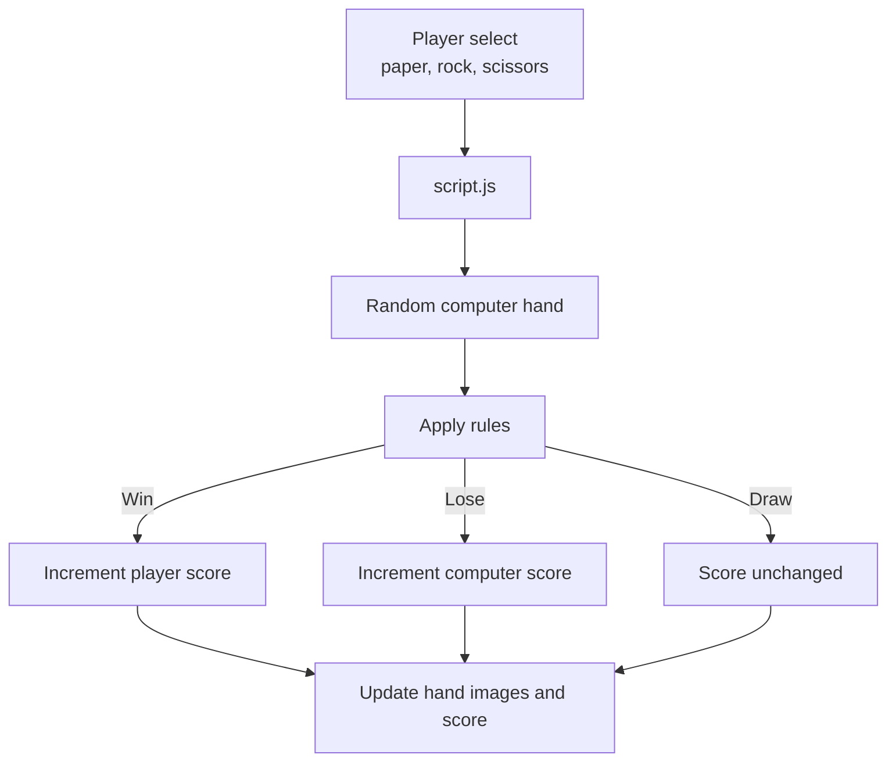
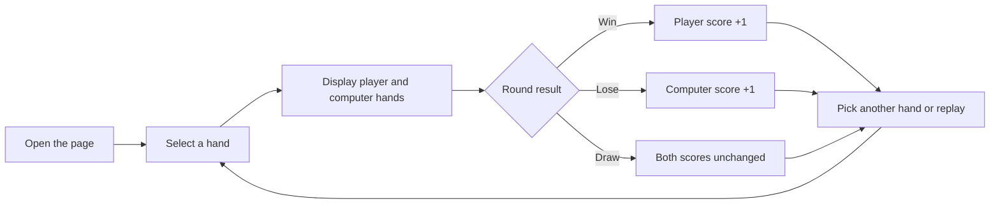

<div align="center">


<p><strong>A browser version of the classic hand game with a live score and a one-click replay.</strong></p>

</div>

<div align="center">

<a href="https://github.com/mohammed-laabidi/rock-paper-scissors-game"></a>
<a href="https://github.com/mohammed-laabidi/rock-paper-scissors-game/fork"></a>
<a href="https://github.com/mohammed-laabidi/rock-paper-scissors-game/issues"></a>


</div>

<div align="center">

<a href="https://mohammed-laabidi.github.io/rock-paper-scissors-game/"><strong>Live Demo</strong></a>
&nbsp;&nbsp;|&nbsp;&nbsp;
<a href="https://github.com/mohammed-laabidi/rock-paper-scissors-game">Repository</a>

</div>

## Overview

Rock Paper Scissors is a two-panel game in which the player picks a hand and the computer answers with a random one. The chosen images are shown side by side under the labels You and Computer, and the running score is displayed between them.

The logic compares the two choices using the standard rules: rock beats scissors, scissors beats paper, and paper beats rock. Each round updates the score, and the Replay button reloads the page to start a fresh match.

The project is intentionally small and dependency-free, and it is a compact example of DOM updates driven by a random choice.

## Features

<table>
<tr>
<td width="50%" valign="top">


### Three hand choices

Paper, rock, and scissors thumbnails let the player pick a hand with a single click.

</td>
<td width="50%" valign="top">


### Random computer move

The opponent picks one of the three hands at random on every round.

</td>
</tr>
<tr>
<td width="50%" valign="top">


### Live scoreboard

The score for the player and the computer is updated after each round and displayed in the center column.

</td>
<td width="50%" valign="top">


### Replay button

A single button resets the match by reloading the page.

</td>
</tr>
</table>

## Technology Stack

<div align="center">


</div>

| Technology | Purpose |
| --- | --- |
| HTML5 | Game board, hand thumbnails, and score markup |
| CSS3 | Two-panel layout, image sizing, and three responsive breakpoints |
| JavaScript | Random computer choice, rule evaluation, and score updates |
| PNG assets | Hand illustrations stored in `images/` |
| GitHub Pages | Static hosting of the live demo |

## Architecture

The game state is a pair of counters and the two hand images. All logic runs in the browser.



## Application Flow



## Project Structure

```text
rock-paper-scissors-game/
├── index.html
├── style.css
├── script.js
├── images/
│   ├── paper_hand.png
│   ├── rock_hand.png
│   └── scissors_hand.png
└── README.md
```

## Getting Started

### Prerequisites

A modern browser. No dependencies or build step are required.

### Installation

```bash
git clone https://github.com/mohammed-laabidi/rock-paper-scissors-game.git
cd rock-paper-scissors-game
```

Open `index.html` in a browser, or serve the folder locally:

```bash
python -m http.server 8000
```

## Usage

1. Select paper, rock, or scissors in the left panel.
2. Read the computer hand in the right panel and the updated score in the middle.
3. Continue playing; the counters keep the total for the current match.
4. Select Replay to reset the score and start again.

## Deployment

The live demo is served by GitHub Pages from the repository root. Any static host can serve the folder directly.

## Author

<table>
<tr>
<td valign="top">

**Mohammed Laabidi**

<a href="https://github.com/mohammed-laabidi"> GitHub</a>
&nbsp;&nbsp;
<a href="https://www.linkedin.com/in/mohammed-laabidi-793a40436"> LinkedIn</a>
&nbsp;&nbsp;
<a href="mailto:mohammed-laabidi@gmail.com"> Email</a>

</td>
</tr>
</table>

---

If this project is useful to you, consider giving the repository a star.
